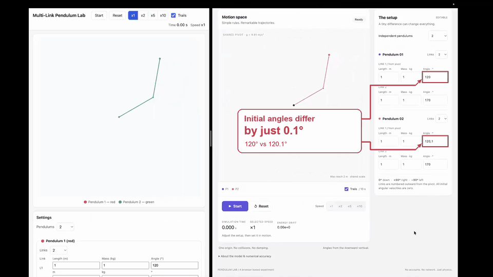

# Pendulum: Qwen vs OpenAI

A local **Qwen3.8-27B** and **OpenAI GPT-6 Astra** built the same multi-link pendulum simulator using Pi CLI and an [identical prompt](prompt.txt). Both produced working HTML applications with nonlinear physics and adaptive integration.

**Open in your browser:** [Qwen simulation](https://lechatpeluche.github.io/pendulum/qwen/) · [OpenAI simulation](https://lechatpeluche.github.io/pendulum/gpt/)

*Qwen on the left, OpenAI on the right. The highlighted initial angles differ by 0.1°.*

Each app supports up to four pendulums with four links each, configurable lengths, masses and angles, pause/reset, speed controls, and fading trails. The stack is HTML, CSS, JavaScript and Canvas 2D, all in one file. You can also open `qwen/index.html` or `gpt/index.html` locally.

## Run data

Completed runs: September 13–14, 2026.

| Setup | Local Qwen | OpenAI |
|:---|:---|:---|
| Model | Qwen3.8-27B, Q4_K_M | GPT-6 Astra |
| Model ID | `qwen3.8-27b-pi` | `gpt-6-astra` |
| Harness | Pi CLI 0.85.1 | Pi CLI 0.85.1 |
| Tools | read, write, edit, bash | read, write, edit, bash |
| Backend | Local llama-server, supplied with Ollama | OpenAI subscription / Responses |
| Reasoning | Medium; configured 8,192-token thinking budget per request | High |
| Registered context | 131,072 tokens | 272,000 tokens |

| Measurement | Qwen | OpenAI |
|:---|---:|---:|
| **Active task time** | **2 h 8 min 57 s** | **17 min 57 s** |
| First HTML write | ~36 min 58 s | ~7 min 22 s |
| Input tokens, excluding cache reads | 132,161 | 47,350 |
| Cache-read tokens | 2,366,097 | 629,120 |
| Cache-write tokens reported | 0 | 0 |
| Output tokens, including reasoning | 89,516 | 29,892 |
| **Total recorded tokens** | **2,587,774** | **706,362** |
| Average output throughput¹ | 11.95 tokens/s | 29.01 tokens/s |
| Tool calls | 52 | 27 |
| Tool results flagged as errors | 7 | 3 |
| Assistant responses | 50 | 24 |
| Context compactions | 1 successful | 0 |
| Compaction time, included in task time | 15 min 59 s | 0 |

Active time includes requests, tools and compaction. Token totals sum input, cache reads, cache writes and output across requests, including repeated context. Qwen's compaction contributed 60,480 tokens to its total.

¹ Implementation output divided by the summed response intervals: `80,908 / 6,772.001 s` and `29,892 / 1,030.398 s`. The intervals include input processing, reasoning, generation and transport; compaction is excluded from this rate.

## Results

**Both models completed the task and implemented the coupled pendulum mathematics successfully within the tested cases.** Both used adaptive Dormand–Prince 5(4) integration. Their checks covered equilibrium, constant link lengths, single- and multi-link dynamics, energy drift and convergence.

| Validation | Qwen | OpenAI |
|:---|:---|:---|
| Model-written suites | 93 assertions passed | 12 physics + 11 Chrome groups passed |
| Same additional browser smoke check | 14/15 | 15/15 |

OpenAI finished its recorded run **7.18× faster**, with fewer output tokens and tool calls. Qwen completed a successful compaction and continued to the final result.

One Qwen UI issue remains: configuration fields stay enabled during motion and pause, while the state model rejects edits. The published application retains this behavior.

These are single completed runs with different reasoning settings, system instructions, backends, context limits and cache conditions. Earlier interrupted Qwen attempts and setup tuning are outside the table. The applications and model-written tests are preserved byte-for-byte; the demo annotations and this README were added afterward.
